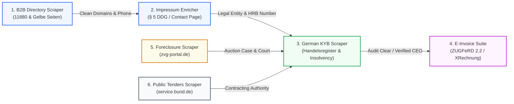

<div align="center">

# 🇩🇪 DACH & German B2B Data, Compliance & PropTech API Suite
### Official Open-Source Integration Hub for Apify Actors, AI Agents (MCP), n8n & Make.com

[](https://apify.com/AGrunert)
[](LICENSE)
[](https://modelcontextprotocol.io/)
[](workflows/n8n_dach_b2b_lead_to_kyb_pipeline.json)
[](workflows/make_com_dach_b2b_blueprint.json)
[](https://apify.com/AGrunert)

<br/>

**The comprehensive, enterprise-grade data automation suite for Germany, Austria, and Switzerland (DACH).**  
Turnkey integration into **Claude Desktop, Cursor AI, Windsurf, LangChain, n8n, Make.com, and Python/Node.js microservices**.

[Overview](#overview) • [The 6 Actors](#the-6-specialized-actors) • [Public Tasks](#13-turnkey-public-tasks) • [AI Agent Setup (MCP)](#ai-agent--mcp-setup-claude-cursor-windsurf) • [Workflow Automation](#workflow-automation-n8n--makecom) • [Quickstart Code](#code-quickstarts) • [Deutsche Dokumentation](#-deutsche-dokumentation--b2b-use-cases)

</div>

---

## 🏛️ Architecture & End-to-End B2B Data Flow

Our 6 cloud actors seamlessly chain together to build complete, compliant outbound lead generation, credit risk evaluation, and billing pipelines:



---

## 🚀 The 6 Specialized Actors

| # | Actor Name & Apify Store Link | Primary Capabilities | Standards & Data Sources | Pricing |
|---|---|---|---|---|
| **1** | [**German E-Invoice Suite**](https://apify.com/AGrunert/german-e-invoice-zugferd-xrechnung-suite) | Generate DIN 5008 PDF/A-3, embed XML into PDF, or validate incoming invoices | ZUGFeRD 2.2, Factur-X, XRechnung 3.0, EN 16931, KoSIT | Pay-Per-Event ($0.01 / invoice) |
| **2** | [**German Company KYB & Insolvency**](https://apify.com/AGrunert/german-company-kyb-insolvency-scraper) | Extract managing directors (Geschäftsführer), registered share capital, HRB & insolvency status | Official Handelsregister (XJustiz 3.5.1), Insolvenzbekanntmachungen | Pay-Per-Event ($0.015 / audit) |
| **3** | [**German Foreclosures (ZVG-Portal)**](https://apify.com/AGrunert/german-real-estate-foreclosure-zvg-scraper) | Bulk scrape real estate auctions across all 16 states, market values in EUR, and appraisal PDFs | zvg-portal.de, Amtsgerichte | Pay-Per-Event ($0.005 / listing) |
| **4** | [**German Public Tenders (Bund.de)**](https://apify.com/AGrunert/german-public-tenders-vergabe-scraper) | Monitor public procurement & IT/construction tenders with CPV codes & bidding document URLs | service.bund.de, Bund & Länder | Pay-Per-Event ($0.005 / tender) |
| **5** | [**German Impressum & Contact Enricher**](https://apify.com/AGrunert/german-impressum-b2b-lead-enricher) | Extract C-level executives, de-obfuscated emails, direct phone, HRB court & VAT ID (§ 5 DDG) | § 5 DDG (formerly TMG), § 25 MedienG, DSGVO | Pay-Per-Event ($0.005 / domain) |
| **6** | [**German B2B Leads & Directory Scraper**](https://apify.com/AGrunert/german-b2b-leads-directory-scraper) | Extract local businesses, crafts (Handwerker), and companies with clean domains & E.164 phones | Gelbe Seiten, 11880, Google-indexed directories | Pay-Per-Event ($0.008 / lead) |

---

## 🎯 13 Turnkey Public Tasks

Every actor comes with preconfigured, 1-click executable public tasks ready to be scheduled or integrated into automations:

| Actor | Public Task Name | Purpose & Preconfigured Scope | Console 1-Click Link |
|---|---|---|---|
| **ZUGFeRD** | `generate-german-e-invoice-sample` | Generate compliant DIN 5008 / EN 16931 PDF/A-3 invoice | [Run Task](https://console.apify.com/actors/tasks/AGrunert~generate-german-e-invoice-sample) |
| **ZUGFeRD** | `validate-extract-e-invoice` | Inspect incoming invoice PDF/XML against official Schematron rules | [Run Task](https://console.apify.com/actors/tasks/AGrunert~validate-extract-e-invoice) |
| **KYB** | `full-kyb-audit` | Complete audit of directors, share capital & insolvency status | [Run Task](https://console.apify.com/actors/tasks/AGrunert~full-kyb-audit) |
| **KYB** | `fast-insolvency-screener` | Rapid screening against official insolvency announcements | [Run Task](https://console.apify.com/actors/tasks/AGrunert~fast-insolvency-screener) |
| **KYB** | `bulk-kyb-batch-check` | Batch verification of multi-company lists in a single run | [Run Task](https://console.apify.com/actors/tasks/AGrunert~bulk-kyb-batch-check) |
| **ZVG** | `german-foreclosures-sample-search` | Search next 20 foreclosure auctions with valuations & court locations | [Run Task](https://console.apify.com/actors/tasks/AGrunert~german-foreclosures-sample-search) |
| **ZVG** | `high-value-commercial-residential-foreclosures` | Target foreclosures with court-assessed value > 250,000 EUR + PDF reports | [Run Task](https://console.apify.com/actors/tasks/AGrunert~high-value-commercial-residential-foreclosures) |
| **Tenders** | `german-it-software-public-tenders` | Search open federal & municipal contracts for IT, Cloud, Software & AI | [Run Task](https://console.apify.com/actors/tasks/AGrunert~german-it-software-public-tenders) |
| **Tenders** | `german-construction-facility-tenders` | Monitor public construction (VOB/A), infrastructure & facility management | [Run Task](https://console.apify.com/actors/tasks/AGrunert~german-construction-facility-tenders) |
| **Impressum** | `german-b2b-impressum-contact-extractor` | Extract CEOs, direct emails, phone & HRB from target domains | [Run Task](https://console.apify.com/actors/tasks/AGrunert~german-b2b-impressum-contact-extractor) |
| **Impressum** | `impressum-to-handelsregister-kyb-enricher` | Enrich corporate websites with register filings and VAT IDs (DE, ATU, CHE) | [Run Task](https://console.apify.com/actors/tasks/AGrunert~impressum-to-handelsregister-kyb-enricher) |
| **Leads** | `german-crafts-trades-lead-finder` | Extract craftsmen, electrical, solar & construction trades with phone | [Run Task](https://console.apify.com/actors/tasks/AGrunert~german-crafts-trades-lead-finder) |
| **Leads** | `german-b2b-domains-for-impressum-enrichment` | Discover German B2B companies with `require_website: true` | [Run Task](https://console.apify.com/actors/tasks/AGrunert~german-b2b-domains-for-impressum-enrichment) |

---

## 🤖 AI Agent & MCP Setup (Claude, Cursor, Windsurf)

You can connect all 6 tools directly to your LLM agent using the official Model Context Protocol (MCP).

### 1. Claude Desktop Setup
Add this to your `%APPDATA%\Claude\claude_desktop_config.json` (Windows) or `~/Library/Application Support/Claude/claude_desktop_config.json` (macOS):

```json
{
  "mcpServers": {
    "apify-german-b2b-suite": {
      "command": "npx",
      "args": [
        "-y",
        "@apify/actors-mcp-server",
        "--actors",
        "AGrunert/german-e-invoice-zugferd-xrechnung-suite,AGrunert/german-company-kyb-insolvency-scraper,AGrunert/german-real-estate-foreclosure-zvg-scraper,AGrunert/german-public-tenders-vergabe-scraper,AGrunert/german-impressum-b2b-lead-enricher,AGrunert/german-b2b-leads-directory-scraper"
      ],
      "env": {
        "APIFY_TOKEN": "YOUR_APIFY_TOKEN"
      }
    }
  }
}
```

### 2. Cursor AI & Windsurf Setup
In Cursor (`Settings -> Features -> MCP -> Add New MCP Server`) or `.cursor/mcp.json`, use the SSE endpoint:
```
https://mcp.apify.com?actors=AGrunert/german-e-invoice-zugferd-xrechnung-suite,AGrunert/german-company-kyb-insolvency-scraper,AGrunert/german-real-estate-foreclosure-zvg-scraper,AGrunert/german-public-tenders-vergabe-scraper,AGrunert/german-impressum-b2b-lead-enricher,AGrunert/german-b2b-leads-directory-scraper&token=YOUR_APIFY_TOKEN
```

### Sample Agent Prompts
- *"Check if BioNTech SE in Mainz has any active insolvency proceedings and retrieve its registered share capital and legal directors."*
- *"Extract all electrical contractors in Munich with websites, then parse their Impressum for CEO names and verify their HRB numbers."*
- *"Search service.bund.de for all open AI and Cloud architecture tenders with deadlines in the next 3 weeks."*
- *"Generate a tax-compliant DIN 5008 / EN 16931 ZUGFeRD 2.2 Comfort PDF/A-3 invoice for Acme Corp with 10 hours consulting."*

---

## ⚡ Workflow Automation (n8n & Make.com)

Ready-to-use blueprint files are available in [`workflows/`](workflows/):

- **n8n Pipeline:** [`workflows/n8n_dach_b2b_lead_to_kyb_pipeline.json`](workflows/n8n_dach_b2b_lead_to_kyb_pipeline.json)  
  *Automates B2B Lead Scraping ➡️ Impressum CEO Enrichment ➡️ KYB Handelsregister & Insolvency Verification in one flow.*
- **Make.com Blueprint:** [`workflows/make_com_dach_b2b_blueprint.json`](workflows/make_com_dach_b2b_blueprint.json)  
  *Modular webhook-triggered scenario chaining lead generation and legal entity verification.*

---

## 💻 Code Quickstarts

### Python (Sync REST Call)
```bash
pip install httpx
export APIFY_TOKEN="your_token_here"
python examples/run_suite_python.py
```

### Node.js (Modern ESM Fetch)
```bash
export APIFY_TOKEN="your_token_here"
node examples/run_suite_node.mjs
```

### 1-Click cURL
```bash
export APIFY_TOKEN="your_token_here"
bash examples/run_suite_curl.sh
```

---

## 📊 Live Sample Datasets

Explore real sample outputs in [`samples/`](samples/) formatted as JSON and CSV:

- 📄 [`samples/01_zugferd_xrechnung_sample.json`](samples/01_zugferd_xrechnung_sample.json) (EN 16931 PDF/A-3 & Schematron validation)
- 🏢 [`samples/02_handelsregister_kyb_sample.json`](samples/02_handelsregister_kyb_sample.json) & [`.csv`](samples/02_handelsregister_kyb_sample.csv) (BioNTech, Deutsche Börse, Celonis)
- 🏠 [`samples/03_zvg_foreclosures_sample.json`](samples/03_zvg_foreclosures_sample.json) & [`.csv`](samples/03_zvg_foreclosures_sample.csv) (Foreclosures with EUR market values & PDF URLs)
- 🏛️ [`samples/04_public_tenders_sample.json`](samples/04_public_tenders_sample.json) & [`.csv`](samples/04_public_tenders_sample.csv) (Bund.de public procurement tenders & CPV codes)
- 🔍 [`samples/05_impressum_leads_sample.json`](samples/05_impressum_leads_sample.json) & [`.csv`](samples/05_impressum_leads_sample.csv) (§ 5 DDG CEOs, emails, phones, HRB & VAT IDs)
- 🔨 [`samples/06_b2b_crafts_directory_sample.json`](samples/06_b2b_crafts_directory_sample.json) & [`.csv`](samples/06_b2b_crafts_directory_sample.csv) (Crafts, trades & local business leads)

---

## 🇩🇪 Deutsche Dokumentation & B2B Use Cases

Die **German B2B Data Suite** löst zentrale Automatisierungsaufgaben im DACH-Raum:

### 1. Handelsregister API & Insolvenzprüfung (KYB)
Ermöglicht automatisierte Know-Your-Business-Prüfungen (KYB) für Banken, Fintechs und B2B-Plattformen:
- Abfrage des amtlichen Handelsregisters nach **Amtsgericht, HRB-Nummer, Stammkapital, Rechtsform und Geschäftsführern/Vorständen**.
- Live-Gegenprüfung mit den amtlichen **Insolvenzbekanntmachungen**, um Ausfallrisiken bei Neukunden im Onboarding sofort zu identifizieren.

### 2. Impressum Scraper (§ 5 DDG / ehemals TMG)
Automatisierte B2B-Lead-Anreicherung von Unternehmens-Domains:
- Erkennt Impressum- und Kontaktseiten deutscher, österreichischer und Schweizer Firmenwebsites.
- Extrahiert verifizierte **Vertretungsberechtigte (Geschäftsführer, Inhaber), E-Mail-Adressen, Telefonnummern im E.164-Format, USt-IdNr. (DE/ATU/CHE) und Handelsregister-Aktenzeichen**.

### 3. ZVG Zwangsversteigerungen API (zvg-portal.de)
Entwickelt für PropTechs, Family Offices und Immobilien-Investoren:
- Flächendeckendes Scraping aller 16 Bundesländer für anstehende Versteigerungstermine.
- Strukturierte Extraktion von **Verkehrswert in Euro (Fließkommazahl), Objekttyp, Aktenzeichen, Gericht und direkten Download-Links zu den amtlichen Gutachten-PDFs**.

### 4. Öffentliche Ausschreibungen API (service.bund.de)
Automatisches Vergabemonitoring für Vertriebsteams und Berater:
- Überwacht öffentliche Ausschreibungen nach CPV-Codes, Schlagwörtern (*Cloud, Software, KI, Bau*) und Bundesländern.
- Liefert Fristen, Vergabestellen und direkte Links zu den Vergabeplattformen (eVergabe, Deutsche eVergabe).

### 5. ZUGFeRD & XRechnung API (E-Rechnung 2025/2026)
Vollständige Konformität mit der gesetzlichen E-Rechnungspflicht ab 2025:
- Erzeugung rechtskonformer **ZUGFeRD 2.2 / Factur-X / XRechnung 3.0 PDF/A-3 Rechnungen** aus JSON.
- Validierung eingehender XML-Rechnungen gegen offizielle **KoSIT Schematron- und EN 16931-Validierungsregeln**.

---

## 🔒 Security & Privacy Notice

- This showcase repository contains **NO** private API keys or proprietary scraping implementations.
- All actors run autonomously in the secure [Apify Cloud](https://apify.com) infrastructure.
- Always adhere to local data protection laws (GDPR / DSGVO) when storing and processing business contact information.

## 📄 License

This open-source suite and integration blueprints are distributed under the [MIT License](LICENSE).
