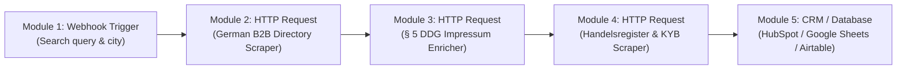

# [Make Blueprint] Automated German B2B Lead Enrichment & Compliance Pipeline (§ 5 DDG Impressum + Official Handelsregister KYB)

Hey Make Community! 👋

If you are setting up B2B outbound automation, lead enrichment, or supplier onboarding in the DACH region (Germany, Austria, Switzerland), you've probably faced the challenge of turning raw company names or websites into **legally compliant, verified corporate profiles**.

In Germany, companies must comply with § 5 DDG (Digital Services Act, formerly TMG), requiring an **Impressum** (Legal Notice) with verified managing directors, registration courts, and VAT IDs. Furthermore, ensuring creditworthiness and compliance requires auditing the official **Handelsregister** (Commercial Register) and checking for active insolvency proceedings.

We have published a ready-to-import **Make.com Blueprint** that automates this entire pipeline with zero browser overhead.

---

## 🏗️ Scenario Architecture

The scenario links 3 specialized commercial Apify micro-services via native HTTP modules:

### Module Breakdown:
1. **Module 1: Custom Webhook**
   - Receives target search parameters (e.g. `search_term`: `"Photovoltaik"`, `location`: `"München"`).
2. **Module 2: German B2B Leads Directory Scraper** (`german-b2b-leads-directory-scraper`)
   - Queries 11880 & Gelbe Seiten via reverse-engineered JSON endpoints.
   - Outputs verified company name, category, E.164 normalized phone number, address, and clean domain.
3. **Module 3: German Impressum & Contact Enricher** (`german-impressum-b2b-lead-enricher`)
   - Resolves the corporate website's § 5 DDG Impressum page.
   - De-obfuscates emails, identifies managing directors (*Geschäftsführer*), and extracts commercial register numbers (*HRB*) and VAT IDs (*USt-IdNr.*).
4. **Module 4: German Company KYB & Insolvency Audit** (`german-company-kyb-insolvency-scraper`)
   - Validates the company against the official German Commercial Register (*Handelsregister*) and national insolvency notices (*Insolvenzbekanntmachungen*).
   - Confirms legal status, share capital, statutory officers, and solvency risk (`SOLVENT` vs `INSOLVENCY_PROCEEDING`).

---

## 📥 Blueprint Download & Quickstart

The scenario blueprint is available directly in our open-source GitHub showcase repository:

👉 **[Download Make Blueprint JSON](https://github.com/andregrunert-ctrl/german-b2b-data-suite/blob/main/workflows/make_com_dach_b2b_blueprint.json)**  
*(File path: `workflows/make_com_dach_b2b_blueprint.json`)*

### Setup Instructions (3 Steps):
1. **Import Blueprint:** In Make.com, create a new scenario, click the `...` (More) menu at the bottom toolbar, select **Import Blueprint**, and upload `make_com_dach_b2b_blueprint.json`.
2. **Set Variable:** In the HTTP modules, replace `{{var.apify_token}}` with your Apify API Token (or configure an Environment Variable in your Make team settings).
3. **Connect Destination:** Add your CRM (HubSpot, Salesforce, Pipedrive, Airtable) or Google Sheets module to the end of the pipeline.

---

## 💰 Cost & Performance Efficiency

- **Pay-Per-Event (PPE):** No monthly minimums or costly browser infrastructure.
  - Directory lead extraction: $0.008 USD
  - Impressum & CEO enrichment: $0.005 USD
  - Official KYB & Insolvency check: $0.025 USD
  - **Total Pipeline Cost:** ~$0.038 USD per fully verified, compliance-audited German corporate record.
- **Ultra-Fast Synchronous Execution:** Pure HTTP protocol scraping executes in under 4 seconds per batch, completely avoiding Make module timeouts.

---

## 📚 Resources & Documentation

- 🐙 **GitHub Repository:** [github.com/andregrunert-ctrl/german-b2b-data-suite](https://github.com/andregrunert-ctrl/german-b2b-data-suite)
- 📊 **Actor Documentation:**
  - [German B2B Directory Scraper](https://apify.com/agrunert/german-b2b-leads-directory-scraper)
  - [German Impressum & Legal Enricher](https://apify.com/agrunert/german-impressum-b2b-lead-enricher)
  - [German Company KYB & Insolvency Scraper](https://apify.com/agrunert/german-company-kyb-insolvency-scraper)

Let us know if you have questions or want to integrate custom filters for specific DACH industry verticals! 🚀
