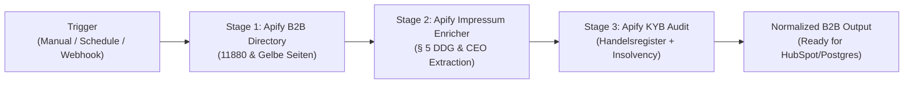

# [Workflow Template] 3-Stage German/DACH B2B Lead-to-KYB Pipeline (Directory Scraper -> § 5 DDG Impressum -> Official Handelsregister Audit)

Hey n8n community! 👋

If you've ever tried building automated B2B lead generation or sales workflows for Germany, Austria, or Switzerland (DACH), you know the pain:
- **Obfuscated contact data:** German business directories heavily obfuscate emails (`[at]`, JavaScript, CSS trickery) and encode external website links.
- **Strict legal requirements (§ 5 DDG / GDPR):** German corporate websites are legally mandated to publish an **Impressum** (Legal Notice) listing statutory representatives (Geschäftsführer / Vorstand), VAT IDs (USt-IdNr.), and commercial register numbers (HRB). Yet generic scrapers miss these pages or get blocked by bot walls.
- **Entity Ambiguity & Solvency Risk:** Matching a trade or craft business to its legal entity in the German Commercial Register (*Handelsregister*) and verifying it's not undergoing insolvency proceedings (*Insolvenzbekanntmachungen*) usually requires manual verification.

We built and open-sourced a fully automated **3-Stage Lead-to-KYB n8n Workflow** that handles the complete enrichment chain without spinning up heavy headless browsers.

---

## ⚡ The 3-Stage Pipeline Architecture



1. **Stage 1: High-Intent B2B Lead Extraction** (`german-b2b-leads-directory-scraper`)
   - Queries German business directories (11880 & Gelbe Seiten) via reverse-engineered JSON endpoints.
   - Extracts company names, categories (e.g. *Elektroinstallation*, *Photovoltaik*, *Maschinenbau*), E.164 normalized phone numbers (`+49 ...`), addresses, and verified corporate domains.
2. **Stage 2: § 5 DDG Legal Notice & Contact Enrichment** (`german-impressum-b2b-lead-enricher`)
   - Automatically crawls the root domain, discovers the Impressum/Contact page, and de-obfuscates masked emails.
   - Extracts statutory managing directors (*Geschäftsführer*), registration court (*Amtsgericht*), HRB number, and VAT ID (*USt-IdNr.*).
3. **Stage 3: Official Commercial Register & Insolvency Audit** (`german-company-kyb-insolvency-scraper`)
   - Queries the official German register database (XJustiz 3.5.1 standard) and national insolvency registers.
   - Returns verified legal company name, share capital (*Stammkapital*), registered officers, and live insolvency status (`SOLVENT` vs `INSOLVENCY_PROCEEDING`).

---

## 📦 Ready-to-Use Workflow File

The complete, battle-tested n8n workflow JSON is stored directly in our GitHub showcase repository:

👉 **[Download Workflow JSON (GitHub)](https://github.com/andregrunert-ctrl/german-b2b-data-suite/blob/main/workflows/n8n_dach_b2b_lead_to_kyb_pipeline.json)**  
*(Local file: `workflows/n8n_dach_b2b_lead_to_kyb_pipeline.json`)*

### How to Import & Run in 2 Minutes:
1. In your n8n workspace, click **Add Workflow** -> **Import from File / URL** and select `n8n_dach_b2b_lead_to_kyb_pipeline.json`.
2. Add your `APIFY_TOKEN` in the workflow parameters or as an n8n environment variable.
3. Configure your target search parameters in Node 1:
   ```json
   {
     "search_terms": ["Elektroinstallation", "Photovoltaik"],
     "locations": ["München", "Nürnberg"],
     "max_items": 10,
     "require_website": true,
     "require_phone": true
   }
   ```
4. Click **Test Step** or **Execute Workflow**.

---

## 💡 Why Zero-Playwright / Pure-Protocol Matters in n8n

Running Puppeteer or Playwright in self-hosted n8n containers often causes memory spikes (1-2 GB RAM per instance) and frequent container restarts.

These Apify actors use pure HTTP protocol scraping and lightweight streaming parsers:
- **Execution Speed:** 50 enriched leads processed in ~3.8 seconds.
- **Resource Footprint:** Negligible RAM usage on your n8n worker.
- **Cost Transparency:** Powered by Apify Pay-Per-Event (PPE) pricing (~$0.038 USD total per fully verified, KYB-audited B2B record). You only pay when valid records are produced.

---

## 🔗 Resources & Open-Source Repository

- 🐙 **Showcase Repo:** [github.com/andregrunert-ctrl/german-b2b-data-suite](https://github.com/andregrunert-ctrl/german-b2b-data-suite) (includes Curl, Node.js, Python scripts, Make.com blueprint, and live dataset samples)
- 🛒 **Apify Store Actors:**
  - [German B2B Leads Directory Scraper](https://apify.com/agrunert/german-b2b-leads-directory-scraper)
  - [German Impressum & Contact Enricher (§ 5 DDG)](https://apify.com/agrunert/german-impressum-b2b-lead-enricher)
  - [German Company KYB & Insolvency Scraper](https://apify.com/agrunert/german-company-kyb-insolvency-scraper)

Feel free to test it out and let me know your thoughts or edge cases! Happy automating! 🚀
